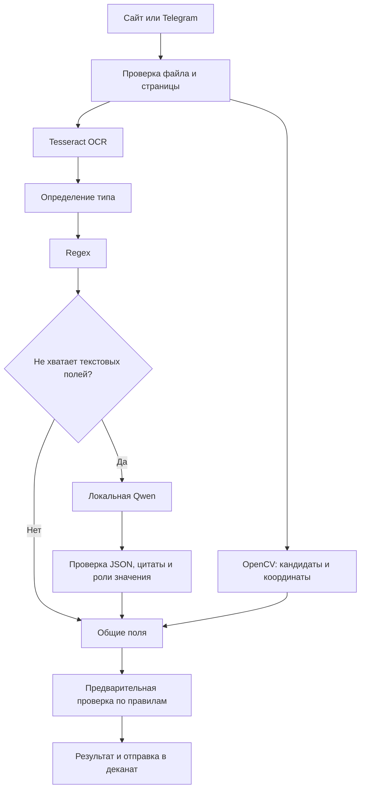
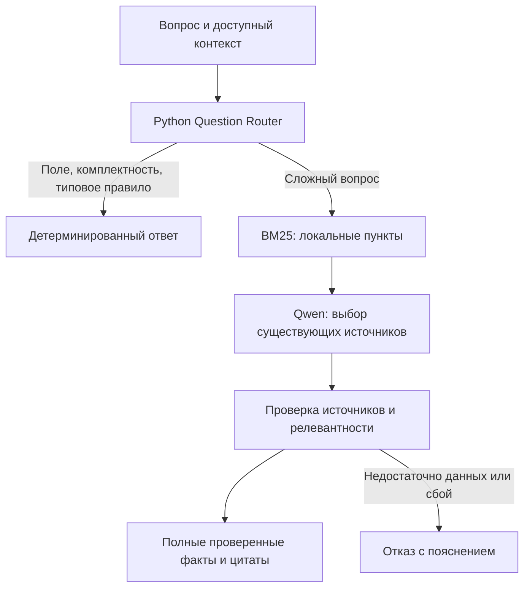

# Онлайн-деканат

Интеллектуальная система обработки студенческих документов: Telegram-бот, веб-приложение и Telegram Mini App помогают извлечь сведения, проверить комплектность и найти ответ в документе или положении. Окончательное решение принимает сотрудник деканата.

## Возможности

- Загрузка JPG, PNG и PDF через сайт или Telegram; проверка содержимого файла, ограничения размера и числа страниц.
- Локальный OCR на русском и английском языках, обработка ориентации и предпросмотр страниц.
- Определение трёх типов: справка об обучении, заявление на академический отпуск, справка о практике. При расхождении с выбором пользователя сайт предлагает изменить или подтвердить тип без повторной загрузки.
- Regex извлекает поля; локальная Qwen дополняет только недостающие текстовые значения. Программа проверяет цитату, тип и контекст значения; найденные поля не подменяются.
- OpenCV ищет визуальные кандидаты печатей и подписей. Сайт показывает координаты, включая увеличенный просмотр. Надпись «Подпись» сама по себе не подтверждает наличие росчерка.
- Предварительная проверка по учебному `rules.md`, ответы по полям и правилам с источниками. Python обрабатывает типовые вопросы; BM25 и Qwen помогают со сложными.
- Одноразовый вход через ссылку или копируемый код из Telegram, сессии, CSRF и проверка владельца обращения.
- Обычные вопросы и вопросы по заявлению получают ответ AI и передаются в деканат. Для заявления прикладываются исходный документ и основные извлечённые поля; деканат видит ответ AI и всегда может ответить своей кнопкой.
- Обращения бота обрабатываются фоновыми задачами; OCR, CV и LLM выполняются в рабочих потоках. Меню доступно во время обработки. Результат проверки документа приходит студенту независимо от доставки вложения в деканат.
- Общая история вопросов и ответов AI и деканата в SQLite через SQLAlchemy по Telegram ID. Команды и сообщения меню в историю не попадают. Вложения хранятся отдельно; сохраняются последние 1000 исходных файлов, сообщения после удаления фото остаются.
- Telegram Mini App с автоматическим входом по подписанным данным Telegram. Пользователь сразу попадает в свой кабинет и видит общую историю бота и сайта.
- Пользовательские типы документов через команды `/add_type`, `/types`, `/remove_type` в чате деканата. Стандартные типы защищены от удаления.
- Установка на Ubuntu 24.04 с Nginx, службами systemd и командами `site start/stop/restart`.
- Тесты, локальная диагностика и воспроизводимые скрипты измерений без передачи документов внешнему LLM/OCR API.

**Ответы на тестовую выборку сохранены в файле [results.json](results.json).**

## Фактический стек

| Технология | Назначение |
|---|---|
| Python 3.12, asyncio, threading | Бот, фоновые задачи, общий обработчик |
| Flask 3.1.0, Jinja2, Werkzeug | HTTP, шаблоны, сессии, локальный сервер |
| Waitress 3.0.2, SQLite, SQLAlchemy 2.0.54 | HTTP-сервер и постоянная история переписки |
| HTML, CSS, обычный JavaScript | Загрузка, чат, страницы, координаты, опрос состояния |
| pyTelegramBotAPI 4.37.0, aiohttp 3.14.5 | Асинхронный Telegram Bot API, long polling |
| Tesseract, pytesseract 0.3.13, Pillow 11.3.0 | OCR `rus+eng`, изображения |
| OpenCV headless 4.14.0.94, NumPy 2.2.3 | Эвристики печатей и подписей |
| pypdfium2 5.14.0 | Рендер PDF и чтение текстовых положений |
| `re`, собственные схемы | Regex, нормализация полей и детерминированные проверки |
| Qwen3-4B-Instruct-2507 Q4_K_M, llama.cpp b11429 | Локальная генерация GGUF, один постоянно загруженный сервер |
| Собственный BM25 | Локальный поиск пунктов, файловый индекс и ссылки `rule:*` / `kb:*` |
| jsonschema 4.25.1, python-dotenv 1.2.4 | Проверка JSON и загрузка настроек |
| unittest, Playwright 1.64.0, Ruff 0.17.0 | Модульные, интеграционные, браузерные проверки и стиль |

Прямые зависимости закреплены в `requirements.txt`; инструменты разработки — в `requirements-dev.txt`. Для выбранного инференса не нужны PyTorch и Transformers. Клиент использует стандартный `http.client`. Адаптер Ollama присутствует, но эта установка и измерения выполнены на llama.cpp.

## Архитектура

```text
main.py                     запуск бота и Flask в одном процессе
handlers/                   меню, обращения, ответы деканата
webapp/
  app.py                    HTTP, вход, CSRF, права доступа
  service.py                фоновые задачи и доставка обращений
  store.py                  сессии входа и доступ к постоянной истории
  templates/  static/       интерфейс
utils/
  database.py               таблицы SQLite через SQLAlchemy Core
  storage.py                история, обращения, файлы и лимит вложений
  telegram_auth.py          проверка подписи и срока действия initData
  application_types.py      стандартные и пользовательские типы документов
  documents.py              безопасное чтение изображений/PDF
  ocr.py                    общий OCR/CV/извлечение
  document_fields.py        схемы и Regex
  hybrid_extraction.py      Qwen fallback и проверка цитат
  document_cv.py            визуальные признаки и координаты
  document_classification.py  тип документа
  document_policy.py        чистые правила и адаптер формата
  document_validation.py    проверки документа без зависимости от Telegram
  document_rules.py         совместимый публичный фасад
  question_answering.py      маршрутизация и проверенные ответы
  knowledge.py              локальный индекс BM25
  local_ai.py               клиент, очередь, JSON, тайм-ауты
  config.py                 настройки окружения
rules.md                    учебное положение, источник правил
scripts/                    установка, диагностика, индекс, бенчмарки
deploy/                     установщик Ubuntu и серверная команда site
results.json                ответы на тестовую выборку
tests/                      синтетические фикстуры и проверки
docs/                       подробная документация и агрегаты измерений
.env.example                полный пример конфигурации
.github/workflows/           автоматические проверки
```

Бот и сайт используют общий `utils.ocr.analyze_document` и `QuestionEngine`. OCR, CV, извлечение и правила не зависят от Flask или Telegram. Карта зависимостей и границы — в [docs/ARCHITECTURE.md](docs/ARCHITECTURE.md); причины переносов и очистки — в [docs/CLEANUP.md](docs/CLEANUP.md).





Серверная установка, управление типами, хранение переписки и подключение Mini App описаны в [docs/SERVER.md](docs/SERVER.md).

## Системные требования

Локальный запуск проверен на **Windows x64, Python 3.12, Intel Core i5-1135G7 (4 ядра / 8 потоков), около 16 ГБ RAM**. Qwen запускалась на CPU с четырьмя вычислительными потоками; для этого режима дискретная GPU не требуется. Отдельно проверен запуск через Vulkan на Intel Iris Xe. Основной сравнительный прогон выполнен на CPU.

Серверная установка проверена на **Ubuntu 24.04 x64, 4 vCPU и 8 ГБ RAM**: сайт, бот, SQLite, OCR и Qwen работают на одном VPS. Автоматический установщик `deploy/install.sh` рассчитан только на Ubuntu 24.04 x64 с systemd и проверяет ОС и архитектуру перед установкой.

Скрипт установки модели `scripts/setup_local_ai.py` загружает готовые сборки llama.cpp для Windows x64 или Ubuntu x64. Совместимость этой Linux-сборки с другими дистрибутивами, включая Debian, не проверялась. Автоматическая установка модели для macOS не реализована; запуск на macOS не проверялся.

Минимальные требования к RAM и диску отдельно не измерялись; выше приведены конфигурации, на которых проверена работа приложения. Файл модели GGUF занимает **2 497 281 120 байт** (около 2,5 ГБ). Дополнительно нужно место для окружения Python, Tesseract с языковыми данными, llama.cpp, базы переписки и вложений.

Нужен доступ к Telegram API из Python. Для установки нужны PyPI, GitHub и Hugging Face; после загрузки OCR и модель работают локально. Веса и Tesseract не включены в Git.

## Установка на Windows

Все команды ниже выполняются в PowerShell из корня проекта, если не указано иначе.

### 1. Python и Git

Установите [Python 3.12](https://www.python.org/downloads/windows/) и [Git for Windows](https://git-scm.com/download/win). Затем откройте новый терминал:

```powershell
py -3.12 --version
git --version
git clone https://github.com/grozzz1/online_decanat_project.git
cd online_decanat_project
git switch main
py -3.12 -m venv .venv
.\.venv\Scripts\Activate.ps1
python -m pip install -r requirements.txt
python -m pip check
```

При запрете `Activate.ps1` можно разрешить выполнение только для текущего терминала:

```powershell
Set-ExecutionPolicy -Scope Process -ExecutionPolicy Bypass
.\.venv\Scripts\Activate.ps1
```

Активация необязательна: далее команды явно используют `.venv\Scripts\python.exe`.

Если `py -3.12` сообщает `No installed Python found`, используйте установленный интерпретатор напрямую. Для стандартного пользовательского каталога эта команда проверена на машине разработки:

```powershell
& "$env:LOCALAPPDATA\Programs\Python\Python312\python.exe" -m venv .venv
```

### 2. Tesseract и языки

По [официальной инструкции Tesseract для Windows](https://tesseract-ocr.github.io/tessdoc/Installation.html#windows) скачайте установщик UB Mannheim. В установщике выберите английские и русские данные; желательно также `osd` для ориентации. `pip install pytesseract` устанавливает только Python-обёртку.

```powershell
Start-Process 'https://github.com/UB-Mannheim/tesseract/wiki'
# После установки в стандартный каталог:
& 'C:\Program Files\Tesseract-OCR\tesseract.exe' --version
& 'C:\Program Files\Tesseract-OCR\tesseract.exe' --list-langs
```

В списке должны быть `rus` и `eng`. Приложение использует `TESSERACT_CMD`, затем существующий `tools/tesseract/tesseract.exe`, затем команду `tesseract` из PATH. Укажите реальный путь в `.env`, если он отличается.

Для стандартной установки без настройки PATH запишите в `.env`:

```dotenv
TESSERACT_CMD=C:/Program Files/Tesseract-OCR/tesseract.exe
```

### 3. Настройки

При первой установке скопируйте пример; существующий `.env` сохраняйте:

```powershell
if (-not (Test-Path .env)) { Copy-Item .env.example .env }
notepad .env
```

Создайте бота командой `/newbot` у [@BotFather](https://t.me/BotFather), сохраните токен в `BOT_TOKEN`. Добавьте бота в чат деканата и отдельный закрытый чат журнала. Укажите их числовые ID, обычно отрицательные для групп. ID можно получить из входящего обновления Bot API; описание поля — в [Telegram Chat](https://core.telegram.org/bots/api#chat). Не публикуйте токен и не вставляйте URL с ним в отчёты.

| Переменная | Значение и назначение |
|---|---|
| `BOT_TOKEN` | Обязательный токен BotFather |
| `DEAN_CHAT_ID` | Обязательный целочисленный ID чата сотрудников |
| `ADMIN_LOG_CHAT_ID` | Обязательный целочисленный ID закрытого журнала |
| `PUBLIC_BASE_URL` | Публичный адрес сайта; для Mini App нужен `https://ваш-домен` |
| `DATA_DIR` | Каталог SQLite и вложений; по умолчанию `private_data` |
| `WEB_HOST`, `WEB_PORT` | Адрес и порт HTTP-сервера; по умолчанию `127.0.0.1:5000` |
| `TESSERACT_CMD` | Путь к OCR; пустое значение включает поиск по умолчанию |
| `DOCUMENT_CV_DEBUG_DIR` | Необязательная папка отладочных изображений с содержимым документа; храните приватно |
| `LOCAL_AI_ENABLED` | `1` — генерация включена, `0` — OCR/Regex/CV/Python QA без Qwen |
| `LOCAL_AI_ENGINE` | `llamacpp` — проверенный вариант; адаптер `ollama` отдельно не проверен |
| `LOCAL_AI_URL` | По умолчанию `http://127.0.0.1:18081`; разрешён только loopback HTTP |
| `LOCAL_AI_MODEL` | Имя модели в API: `qwen3-4b-instruct` |
| `LOCAL_AI_TIMEOUT` | Тайм-аут запроса, 90 с; для большого QA-бенчмарка использовалось 180 с |
| `LOCAL_AI_QUEUE_TIMEOUT` | Ожидание единственного слота, 5 с |
| `LOCAL_AI_MAX_TOKENS` | Лимит ответа рабочего клиента, 512 |
| `LOCAL_AI_CONTEXT_CHARS` | Ограничение текстового контекста клиента, 12000 символов |
| `LOCAL_AI_COOLDOWN` | Пауза повторных попыток после недоступности сервера, 30 с |
| `LOCAL_AI_MODEL_PATH` | Необязательный путь GGUF; пусто — файл в `models/` |
| `KNOWLEDGE_PATHS` | Дополнительные локальные MD/TXT/текстовые PDF или каталоги через `;` |

После изменения `.env` перезапустите приложение и, если менялись параметры сервера, модель. Переменные текущего PowerShell имеют приоритет над `.env`: после тестов с `LOCAL_AI_ENABLED=0` установите `1` для генерации либо удалите переопределение командой `Remove-Item Env:LOCAL_AI_ENABLED -ErrorAction SilentlyContinue`.

### 4. Qwen и RAG

```powershell
.\.venv\Scripts\python.exe scripts/setup_local_ai.py
.\.venv\Scripts\python.exe scripts/reindex_knowledge.py
# Оставьте этот терминал работающим; Ctrl+C остановит модель.
.\.venv\Scripts\python.exe scripts/start_local_ai.py --threads 4
```

Установщик загружает [llama.cpp b11429](https://github.com/ggml-org/llama.cpp/releases/tag/b11429) и [Qwen3-4B-Instruct-2507 Q4_K_M от Unsloth](https://huggingface.co/unsloth/Qwen3-4B-Instruct-2507-GGUF/tree/a06e946bb6b655725eafa393f4a9745d460374c9). Ревизия закреплена; SHA256 GGUF проверяется по метаданным. Манифест — `models/installation.json`. Один сервер держит модель в памяти; перезапуск на каждый документ не требуется. Температура 0, seed 42, рассуждения отключены.

Индекс строится из `rules.md` и `KNOWLEDGE_PATHS`; кеш `.local_ai/knowledge.json` автоматически обновляется при изменении файлов. Для сканированного положения сначала нужен OCR. `rules.md` содержит **учебные вымышленные правила**, не действующие нормы конкретного вуза. При замене положения нужно согласовать детерминированные требования в `document_policy.py` и схемах.

Подробности, ограничения и необязательный запуск Vulkan — [docs/LOCAL_AI.md](docs/LOCAL_AI.md).

## Запуск и проверка

Откройте второй терминал на том же компьютере и перейдите в корень проекта. Терминал с моделью оставьте работающим:

```powershell
.\.venv\Scripts\python.exe scripts/doctor.py --ocr --ai --telegram
.\.venv\Scripts\python.exe main.py
```

`main.py` запускает **и Telegram-бота, и Flask через Waitress**: бот работает в asyncio, HTTP-сервер — в отдельном потоке. Отдельно запускать `webapp/app.py` не требуется. На старте проверка Telegram ограничена 15 секундами; при ошибке записывается диагностика, затем продолжается polling.

Отправьте `/start` своему боту и откройте выданную одноразовую ссылку. Также можно скопировать код из ответа бота и ввести его на странице входа.

При локальной установке с настройками по умолчанию сайт доступен по `http://localhost:5000`. Открывайте его в браузере **на том же компьютере, где запущен `main.py`**. Адрес `localhost` указывает на устройство, на котором открыт браузер: ссылка с таким адресом не откроет сайт на вашем компьютере, если перейти по ней с телефона. Для входа с других устройств разверните приложение на VPS и задайте его публичный HTTPS-адрес в `PUBLIC_BASE_URL`, как описано в разделе ниже.

После входа загрузите тестовый документ, проверьте тип, поля и координаты, задайте вопрос. Если определённый тип документа не совпадает с выбранным, сайт приостановит отправку в деканат до подтверждения или изменения типа. В уведомление сотрудникам входят исходное вложение и извлечённые поля со статусами распознавания; полный OCR-текст туда не отправляется.

`doctor.py` проверяет зависимости, импорты, наличие настроек и индекс; при недостающих пакетах выводит их список и команду установки. Его можно запустить даже до установки зависимостей. `--ocr` выполняет реальный OCR синтетической картинки, `--ai` проверяет здоровье сервера, `--telegram` проверяет токен через `getMe` и отсутствие webhook, необходимое для polling. Диагностика не отправляет сообщения в Telegram и не генерирует ответ модели. Настоящий сквозной обмен с Telegram проверяется вручную после запуска.

## VPS и Telegram Mini App

Установщик рассчитан на отдельный Ubuntu 24.04 x64 VPS. После загрузки исходников выполните из корня проекта:

```bash
sudo bash deploy/install.sh
sudo site status
sudo site doctor
```

Установщик ставит зависимости и Nginx, создаёт службы бота, сайта и модели, включает автозагрузку. Управление на сервере: `site start`, `site stop`, `site restart`, `site logs`, `site config`. База и вложения находятся в `/var/lib/online-decanat`, закрытые настройки — в `/etc/online-decanat.env`. Для одного токена должен работать один экземпляр бота: при запуске на VPS остановите локальную копию.

Mini App открывает тот же личный кабинет внутри Telegram. При каждом открытии `/miniapp` браузер передаёт свежий `Telegram.WebApp.initData`; сервер проверяет подпись и срок действия, создаёт сессию для подтверждённого Telegram ID и загружает его историю. Вводить код или токен не требуется. Токен бота хранится только на сервере.

Для подключения Mini App:

1. Направьте домен на VPS, настройте HTTPS и задайте `PUBLIC_BASE_URL=https://ваш-домен`.
2. В BotFather откройте `/mybots` → выберите бота → **Bot Settings → Configure Mini App → Enable Mini App**. Укажите `https://ваш-домен/miniapp`.
3. Для кнопки рядом с полем ввода используйте `/setmenubutton`: название «Открыть деканат», адрес тот же. При настроенном HTTPS команда `/start` также показывает кнопку Mini App.

История из бота и сайта хранится в одной SQLite через SQLAlchemy по Telegram ID. Вложения лежат отдельными файлами, а в базе сохраняются их имена. Общий лимит — 1000 исходных вложений; при превышении удаляются самые старые. Сообщения остаются, а попытка открыть удалённое фото показывает уведомление об истёкшем сроке хранения.

Подробная настройка HTTPS, обновления сервера и команд управления — в [docs/SERVER.md](docs/SERVER.md).

## Тестирование

```powershell
.\.venv\Scripts\python.exe -m pip install -r requirements-dev.txt
$env:LOCAL_AI_ENABLED = '0'
.\.venv\Scripts\python.exe -m unittest discover -s tests -t . -q
.\.venv\Scripts\ruff.exe check .
.\.venv\Scripts\ruff.exe format --check .
.\.venv\Scripts\python.exe scripts/check_publication.py
```

Браузерные сценарии требуют установленного Google Chrome. Они запускают собственный локальный сервер и используют заглушки Telegram/OCR:

```powershell
.\.venv\Scripts\python.exe -m tests.browser_visuals
.\.venv\Scripts\python.exe -m tests.browser_document_types
.\.venv\Scripts\python.exe -m tests.browser_local_ai
.\.venv\Scripts\python.exe -m tests.browser_history
```

Здесь проверяются увеличенный просмотр, мобильная вёрстка, сохранение файла при смене типа, повторная отправка после ошибки, источники полей, AI-ответы, общая история, удаление старых фото и автоматический вход Mini App при смене аккаунта. Отдельные негативные тесты проверяют неизвестные даты, чужие поля, JSON null, цитаты, несуществующие ссылки, тайм-ауты, конкуренцию, CSRF и чужие обращения. CI запускает автономные проверки на Windows/Python 3.12; скачивание модели и работа с настоящим ботом в CI не выполняются.

### Воспроизведение бенчмарков

Предоставленный отдельно учебный набор не публикуется в репозитории. В каталоге набора должны быть `documents.zip`, `documents.json`, `questions.json`, `reference_results.json`, `results.schema.json`, `evaluate.py`, `rules.md`. Это **30 документов**, каждый в PNG и PDF, и 120 вопросов; пары форматов не считаются отдельными независимыми документами.

```powershell
$dataset = 'C:\path\to\online-dean-participants-v1'
$env:LOCAL_AI_ENABLED = '1'
$env:LOCAL_AI_TIMEOUT = '180'
.\.venv\Scripts\python.exe scripts/benchmark_ai.py all --dataset $dataset
.\.venv\Scripts\python.exe scripts/report_local_ai.py
# Небольшие отдельные проверки реальной Qwen:
.\.venv\Scripts\python.exe scripts/stress_local_ai.py
```

`all` выполняет отдельные OCR/CV-прогоны Regex и гибрида, затем три QA-варианта: простой Qwen, строгий Qwen и Python/RAG/Qwen. Эталоны читаются только при оценке сохранённых предсказаний. Скрипт запускает официальный оценщик. Генеративные варианты группируют четыре вопроса: время в сводке амортизировано на вопрос. На CPU полный прогон может занимать больше часа. Промежуточные результаты позволяют продолжить запуск; изменение хеша пайплайна отменяет переиспользование. `--force` пересчитывает выбранную стадию.

`stress_local_ai.py` проверяет ожидаемые результаты шести отдельных проб и возвращает ненулевой код при несовпадении. Это диагностика качества модели: в последней проверке один сценарий восстановления дат не удался, а неверные даты были отклонены. Такой результат сохраняется в отчёте и не заменяется повторениями до удачного ответа.

Отдельная проверка OCR/CV, в том числе PDF:

```powershell
$env:LOCAL_AI_ENABLED = '0'
.\.venv\Scripts\python.exe scripts/benchmark.py run --dataset $dataset --output benchmark_results/pdf --representation pdf
.\.venv\Scripts\python.exe scripts/benchmark.py report --reference "$dataset\reference_results.json" --evaluate "$dataset\evaluate.py" --output benchmark_results/pdf
```

Генерируемые CSV, JSON, документы и логи сохраняются в игнорируемом `benchmark_results/`. Агрегированные результаты и границы их применимости — в [docs/benchmarks/README.md](docs/benchmarks/README.md). Файлы с полными полями, OCR, промптами и ответами нужно хранить приватно.

## Ограничения и диагностика

- История, обращения и ссылки на вложения сохраняются в SQLite. Вложения ограничены 1000 исходных файлов на всё приложение. Сессии входа находятся в памяти; после перезапуска обычному браузеру нужна новая ссылка. Локальный адрес по умолчанию — `127.0.0.1:5000`, публичный адрес настраивается через `PUBLIC_BASE_URL`.
- CV подтверждает визуальный кандидат, не подлинность и не личность подписанта. Низкая уверенность сохраняется как неизвестность. OCR может путать латинские и кириллические символы.
- Поддерживаются файлы до 10 МБ, PDF до 12 страниц, изображения до 20 мегапикселей. Защищённые или повреждённые PDF отклоняются.
- Проверки цитат снижают риск выдуманных значений, но не доказывают смысловую правильность ответа. Для сложных вопросов вывод ограничен проверенными фактами и полными цитатами.
- При недоступной Qwen сохраняются Regex/CV и типовые Python-ответы; сложный запрос получает технический отказ. Модель обслуживает один запрос одновременно, очередь ограничена ожиданием.
- Локальная обработка не означает отсутствия передачи в Telegram: подтверждённые обращения направляются сотрудникам по назначению. Общий AI-журнал не содержит полного OCR и значений полей; приватные результаты содержат их.

| Симптом | Действие |
|---|---|
| `No module named 'utils'` | Запускать из корня командой `python main.py`, а не `python webapp/app.py` |
| `TesseractNotFoundError` | Проверить установку и `TESSERACT_CMD`; выполнить `doctor.py --ocr` |
| Нет `rus.traineddata` | Установить русский язык Tesseract, проверить `--list-langs` |
| Telegram `getMe` / polling timeout | Проверить доступ Python к `api.telegram.org:443`; системный прокси VPN может не охватывать Python, нужен подходящий маршрут/TUN или прокси в инфраструктуре |
| Модель недоступна | Запустить `start_local_ai.py`, проверить `/health` и `doctor.py --ai` |
| Порт 5000 занят | Остановить прежний экземпляр приложения, затем повторить запуск |
| Нет сведений для ответа | Проверить извлечённые поля и локальные правила; не заменять отсутствующее значение догадкой |

Дополнительно: [визуальный анализ](docs/DOCUMENT_CV.md), [поля и схемы](docs/DOCUMENT_FIELDS.md), [история исправления подписи и типа](docs/TYPE_SIGNATURE_FIX.md).

Фактически выполненные проверки и ограничения — [docs/VERIFICATION.md](docs/VERIFICATION.md).
