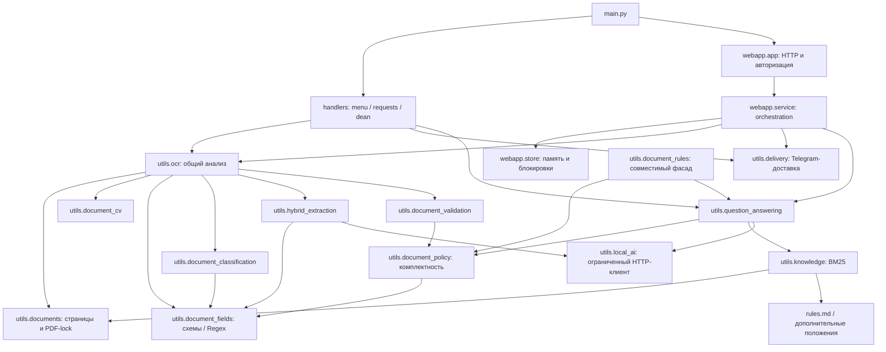

# Архитектура и карта зависимостей

Вход — `main.py`: создаёт `Bot`, регистрирует обработчики, получает event loop и передаёт его Flask-сервису. HTTP работает в потоке Werkzeug, Telegram и фоновые задачи — в общем asyncio loop. HTTP-маршруты вызывают корутины через `run_coroutine_threadsafe`; длительные OCR/CV/LLM выполняются через `to_thread`.

## Зависимости подсистем

`document_rules` остаётся доступным прежним скриптам и внешним импортам. Чистые правила вынесены в `document_policy`: QA больше не импортирует фасад, вызывающий QA. Зависимости OCR/CV/полей/модели направлены от оркестратора к независимым компонентам. Прямых обратных импортов к `webapp` и `handlers` в вычислительных модулях нет.

`document_validation` содержит общие проверки периода, статусов и комплектности. Telegram-предикаты остаются в `validation`, который совместимо экспортирует старые имена проверок. OCR импортирует только независимый модуль. Статические регрессионные тесты проверяют весь граф на циклы и запрещают транзитивные зависимости OCR/QA от Telegram, Flask и обработчиков.

## Основные интерфейсы

| Компонент | Вход → выход |
|---|---|
| `validate_document` / `load_document_pages` | Байты → MIME / канонические RGB-страницы |
| `analyze_document`, async-обёртка | Файл и выбранный тип → OCR, тип, поля, CV, проверки, превью |
| `reprocess_document` | Сохранённые OCR/CV и новый тип → новый разбор без повторной загрузки |
| `extract_document_fields` | OCR, схема, CV → значения, статусы, происхождение |
| `supplement_fields` | Неполное извлечение и OCR → только проверенные дополнения |
| `analyze_document_visuals` | Страница и OCR-координаты → кандидаты с bbox, ролью, статусом |
| `preliminary_check` | Извлечённые поля → комплектность, пропуски/неизвестность, источники |
| `KnowledgeIndex.search` | Вопрос → существующие фрагменты с ID, текстом, оценкой BM25 |
| `QuestionEngine.answer` | Вопрос и контекст → результат официального формата и диагностика |
| `LocalAI.generate` | Промпты и JSON Schema → разобранный ответ или безопасный код ошибки |

## Авторизация и данные

`WebService.create_login` создаёт одноразовый код в `WebStore`; `/login` обменивает его на cookie-сессию. POST API проверяет CSRF и Origin. Чтение файла, смена типа, подтверждение и AI-вопрос проверяют владельца. Ключ подписи cookie генерируется при старте; после перезапуска старые сессии не восстанавливаются.

`WebStore` хранит пользователей, историю, байты файлов и результаты в памяти под блокировкой. Это прототип: постоянной БД, общей памяти нескольких процессов и политики долговременного хранения нет. Контекст Telegram изолирован по паре `(chat_id, user_id)`, доступен не более часа и ограничен числом записей.

Разбор PDF и чтение текстовых PDF для RAG используют общий `RLock`: PDFium не вызывается конкурентно. LLM-клиент ограничен одним слотом с ожиданием, тайм-аутом и паузой после сбоя. Веб-вопрос получает 202 и обрабатывается в фоне; состояние обновляется через существующий polling.

## Правила и проверяемость

`rules.md` — фактический источник цитат. Пункты разбиваются с сохранением ID и SHA256; BM25 хранится в `.local_ai/knowledge.json`. Обязательные поля и привязки пунктов в Python согласованы с данным учебным положением. Замена положения не означает автоматического безопасного изменения этих требований.

Regex имеет приоритет над моделью. Qwen запрашивается только для подходящих недостающих текстовых полей, с проверкой дословной цитаты и роли значения. Визуальные поля из текста модели не принимаются. Сложный QA выбирает существующие источники; итоговая формулировка строится из сохранённых фактов и полных цитат. Свободная генерация не считается проверенной только потому, что прошла JSON Schema.

## Разработка и результаты

Тестовые данные вынесены в `tests/fixtures.py`; сценарии не импортируют их из тестовых классов. Транспорт Telegram подменён. Браузерные проверки дополнительно используют контролируемый OCR, поэтому их прохождение не измеряет качество распознавания. Настоящие OCR и Qwen проверяются отдельно `doctor.py`, `stress_local_ai.py` и парными бенчмарками.

`benchmark_results/` — локальный генерируемый выход, не вход приложения. Источники измерений и официальный оценщик находятся во внешнем учебном наборе. В Git публикуются код воспроизведения и обезличенные агрегаты в `docs/benchmarks/`.
